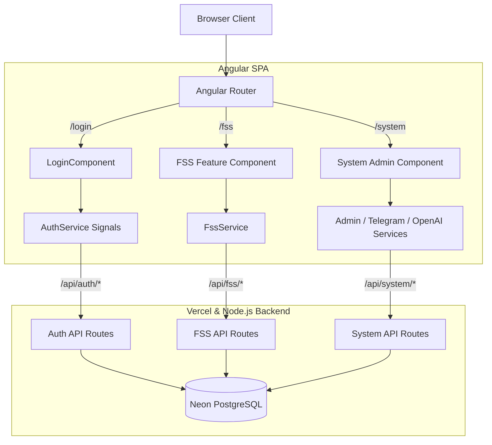

# Requirements

### Overview & Goals
Migrate the existing React/TSX frontend in `marc-be` to a modern Angular Single Page Application (SPA) while preserving the existing Node.js / Next.js backend (`app/api/*`), Neon PostgreSQL database, Telegram bot, OpenAI integration, and single-project Vercel deployment.

### Scope
- **In Scope**:
  - Setting up the latest stable Angular application (standalone components, Signals, Angular Router, HttpClient with fetch).
  - Migrating all existing UI views:
    - Login & Google Authentication view (`LoginView`, `GoogleSignInButton`, `AuthStatusCard`).
    - App layout and navigation (`AppNavbar`, `AppSidebar`, dynamic role-based menus).
    - Fire Safety Solutions (PBŘ) management (`FireSafetySolutionsView`): CRUD, AI field generation, technical document uploads/downloads, and DOCX export.
    - FSS AI Prompt templates administration (`FssPromptsSystemView`).
    - Personal AI Settings (`UserAiSettingsView`).
    - Scheduled Prompts management (`AiPromptsView`).
    - Telegram Bot System administration (`TelegramBotSystemView`, `WebhookDeploymentControls`).
    - OpenAI System diagnostics and usage analytics (`OpenAiSystemView`).
    - System administration (User management, Role definitions, Dynamic Menu Mappings).
  - Retaining all Node.js backend routes in `app/api/` and core libraries in `lib/`.
  - Configuring unified Vercel deployment and routing to ensure SPA direct navigation and backend APIs work seamlessly.
  - Removing obsolete React frontend dependencies and TSX files once migration is validated.
- **Out of Scope**:
  - Angular Server-Side Rendering (SSR) or Prerendering (explicitly disallowed).
  - Modifying existing backend database schema, Neon integration, or API contracts.
  - Splitting into multiple repositories or multiple Vercel projects.

### User Stories
- **As a User**, I want to authenticate seamlessly via Google OAuth and access authorized tools according to my assigned role.
- **As a Fire Safety Specialist**, I want to create and edit Fire Safety Solutions, use AI to generate individual or batch technical assessments, attach technical documentation, and export DOCX reports.
- **As an Administrator**, I want to manage system roles, user access levels, menu mappings, system-level prompt templates, and Telegram bot webhook settings through an intuitive, reactive UI.
- **As a Developer**, I want a unified build pipeline that compiles the Angular SPA and runs backend tests within a single repository and single Vercel deployment.

### Functional Requirements
- **Authentication**:
  - Check active session via `/api/auth/me` on startup.
  - Support Google OAuth redirect flow and Google Sign-In credential exchange.
  - Clear session via `/api/auth/logout`.
- **Navigation & Access Control**:
  - Role-based route guarding (`authGuard`, `roleGuard`).
  - Dynamic sidebar navigation categorized into General, Operations, Administration, and System.
- **Fire Safety Solutions (FSS)**:
  - Form navigation across categories (Identification, Podklady, Posouzení, Únikové cesty, Zabezpečení, Dokumentace).
  - Real-time AI property generation with token and cost tracking.
  - Multipart file upload to `/api/fss/files/upload` and file downloads from `/api/fss/files/[fileId]/download`.
  - DOCX report generation and download from `/api/fss/[id]/export`.
- **AI Settings & Prompts**:
  - Personal API key input and validation against `/api/user/ai-settings/validate`.
  - Scheduled prompts CRUD and manual trigger via `/api/prompts/[id]/run`.
- **System & Telegram Administration**:
  - User role assignment via `/api/auth/users`.
  - Telegram webhook status inspection and test deployment notifications via `/api/telegram/notify-deployment`.

### Non-Functional Requirements
- **Client-Side Performance**: Zero SSR overhead; fast bundle load; Signal-based granular change detection.
- **Maintainability**: Clean Angular standalone architecture, strict TypeScript typing, and separation of UI components from domain services.
- **Compatibility**: 100% API compatibility with existing backend routes in `app/api/`.

# Technical Design

### Current Implementation
- **Backend**: Next.js App Router API routes under `app/api/**/route.ts` communicating with Neon PostgreSQL (`lib/db/index.ts`), GrammY Telegram bot (`lib/telegram/`), OpenAI API (`lib/openai/`), and session management (`lib/auth/`).
- **Frontend**: React TSX components in `app/components/` rendered inside `app/page.tsx`, `app/login/page.tsx`, and `app/register/page.tsx`.
- **Deployment**: Vercel project configuration in `vercel.json` with cron jobs targeting `/api/cron/prompts`.

### Key Decisions
1. **Unified Root Architecture**:
   - Angular source placed in `src/` (`src/app/`, `src/main.ts`, `src/styles.css`) with standard `angular.json`.
   - Angular builds static SPA assets to `dist/browser` (or `public/`).
   - Next.js acts as the backend API host for `/api/*` and rewrites SPA routes to the Angular SPA entrypoint in production.
2. **Signal-Driven Reactivity**:
   - Modern Angular Signals (`signal`, `computed`, `effect`) will power component state and service stores.
   - Angular `HttpClient` configured with `provideHttpClient(withFetch())`.
3. **URL-Based Lazy Routing**:
   - Angular Router with route-level lazy loading (`loadComponent`) and functional `canActivate` guards (`authGuard`, `roleGuard`).
4. **Preserved Backend & APIs**:
   - Zero modifications to backend contracts, DB schema, or cron job schedules.

### Proposed Changes
- **Angular App Setup**:
  - Add Angular CLI and framework dependencies to `package.json`.
  - Configure `angular.json` and `tsconfig.app.json`.
  - Create root configuration `src/app/app.config.ts` and `src/app/app.routes.ts`.
- **Core Layer (`src/app/core/`)**:
  - `services/`: `AuthService`, `FssService`, `AiSettingsService`, `PromptsService`, `OpenAiService`, `TelegramService`.
  - `guards/`: `authGuard`, `roleGuard`.
  - `models/`: Strongly typed TypeScript interfaces mirroring backend contracts.
- **Feature Components (`src/app/features/`)**:
  - `auth/`: `LoginComponent`, `GoogleSignInButtonComponent`.
  - `layout/`: `AppLayoutComponent`, `NavbarComponent`, `SidebarComponent`.
  - `fss/`: `FssListComponent`, `FssFormComponent`, `FssDetailComponent`, `FssPromptsComponent`.
  - `ai-settings/`: `UserAiSettingsComponent`.
  - `prompts/`: `AiPromptsComponent`.
  - `system/`: `SystemAdminComponent`, `TelegramBotComponent`, `OpenAiAnalyticsComponent`, `UsersManagementComponent`, `RolesManagementComponent`.
- **Cleanup**:
  - Remove `app/components/*.tsx`, `app/page.tsx`, `app/login/page.tsx`, `app/register/page.tsx`.
  - Update `package.json` scripts to build Angular SPA prior to running backend/Vercel build.

### Data Models / Contracts
Key shared interfaces in `src/app/core/models/`:
```typescript
export interface User {
  id: string;
  email: string;
  name: string;
  avatarUrl?: string;
  role: string;
  isActive: boolean;
  createdAt?: string;
}

export interface AuthStatusResponse {
  authenticated: boolean;
  user: User | null;
  role: string | null;
  roleInfo: RoleDefinition | null;
  menu: MenuItem[];
  configured: boolean;
}

export interface FireSafetySolution {
  id: string;
  userId: string;
  title: string;
  properties: FireSafetySolutionProperties;
  files: FssTechnicalDocumentationFile[];
  createdAt: string;
  updatedAt: string;
}
```

### File Structure
```text
marc-be/
├── angular.json
├── package.json
├── tsconfig.json
├── tsconfig.app.json
├── vercel.json
├── src/
│   ├── index.html
│   ├── main.ts
│   ├── styles.css
│   └── app/
│       ├── app.config.ts
│       ├── app.routes.ts
│       ├── app.component.ts
│       ├── core/
│       │   ├── guards/
│       │   │   ├── auth.guard.ts
│       │   │   └── role.guard.ts
│       │   ├── models/
│       │   │   ├── auth.models.ts
│       │   │   ├── fss.models.ts
│       │   │   ├── openai.models.ts
│       │   │   └── telegram.models.ts
│       │   └── services/
│       │       ├── auth.service.ts
│       │       ├── fss.service.ts
│       │       ├── ai-settings.service.ts
│       │       ├── prompts.service.ts
│       │       ├── openai.service.ts
│       │       └── telegram.service.ts
│       └── features/
│           ├── auth/
│           │   ├── login.component.ts
│           │   └── google-signin.component.ts
│           ├── layout/
│           │   ├── app-layout.component.ts
│           │   ├── navbar.component.ts
│           │   └── sidebar.component.ts
│           ├── fss/
│           │   ├── fss-list.component.ts
│           │   ├── fss-form.component.ts
│           │   └── fss-prompts.component.ts
│           ├── ai-settings/
│           │   └── user-ai-settings.component.ts
│           ├── prompts/
│           │   └── ai-prompts.component.ts
│           └── system/
│               ├── system-admin.component.ts
│               ├── telegram-bot.component.ts
│               ├── openai-analytics.component.ts
│               └── users-admin.component.ts
├── app/
│   └── api/                  # Existing Next.js API endpoints preserved
└── lib/                      # Existing backend business logic preserved
```

### Architecture Diagram


### Risks & Mitigations
- **Risk**: Client-side routing on page refresh returning 404 on Vercel.
  - *Mitigation*: Configure SPA rewrite rule in `next.config.ts` / `vercel.json` ensuring all non-API paths resolve to Angular SPA's `index.html`.
- **Risk**: Google OAuth cookie handling in cross-origin or standalone SPA scenarios.
  - *Mitigation*: Frontend and backend share the exact same domain on Vercel, allowing HTTP-only session cookies to attach seamlessly.
- **Risk**: Mixed dependencies bloat during migration.
  - *Mitigation*: Isolate Angular dependencies, verify builds incrementally, and cleanly uninstall unused React packages (`react`, `react-dom`, `@types/react`) once TSX files are replaced.

# Testing

### Validation Approach
Automated validation of backend tests and Angular production compilation combined with end-to-end sanity checks on API communication, routing, and Vercel configuration.

### Key Scenarios
- **Authentication Flow**:
  - Anonymous user accessing `/fss` is redirected to `/login` by `authGuard`.
  - Google Sign-In updates `AuthService.currentUser` signal and redirects to `/`.
  - Logout clears session cookies and resets auth state.
- **Fire Safety Solutions Workflow**:
  - Listing FSS records fetched from `/api/fss`.
  - Creating a new FSS record with category tab switching and property population.
  - Triggering individual field AI generation and verifying received assessment text.
  - Uploading a PDF/DWG technical file and downloading it back.
  - Triggering DOCX export and verifying blob download.
- **AI Settings & Scheduled Prompts**:
  - Validating custom OpenAI API key via `/api/user/ai-settings/validate`.
  - Creating a scheduled prompt, toggling active state, and executing manual run.
- **System Administration**:
  - Inspecting Telegram bot webhook status and health metrics.
  - Updating a user's role and verifying dynamic menu changes.

### Edge Cases
- Session expiration during active FSS editing (ensures graceful notification without losing draft inputs).
- Network error or AI service timeout during batch field generation.
- Direct URL access to deep nested routes (e.g. `/fss-prompts`) with refresh (ensuring no 404).

### Test Changes
- Execute existing backend test suite via `npm test` (`test/auth.test.ts`, `test/fire-safety.test.ts`, `test/openai.test.ts`, `test/prompts.test.ts`, `test/prompts-cron.test.ts`, `test/telegram-user-matching.test.ts`, `test/user-ai-settings.test.ts`).
- Run `ng test` or Angular type-check (`ng build --configuration=production`) to guarantee zero compile errors in strict mode.

# Delivery Steps

### ✓ Step 1: Initialize Angular application and build infrastructure
Angular SPA dependencies and configuration files are configured in the repository.
- Install `@angular/core`, `@angular/common`, `@angular/compiler`, `@angular/router`, `@angular/forms`, `@angular/platform-browser`, `@angular/platform-browser-dynamic`, and `@angular/cli`.
- Create `angular.json` configured for a client-side SPA build outputting to `dist/browser` or `public/angular`.
- Set up root `src/main.ts`, `src/index.html`, `src/styles.css`, and `src/app/app.config.ts` with `provideRouter` and `provideHttpClient(withFetch())`.
- Update `tsconfig.json` and create `tsconfig.app.json` with strict mode enabled.
- Add NPM scripts in `package.json` for `build:ng`, `dev:ng`, `build`, and `dev`.

### ✓ Step 2: Implement core services, models, and authentication state
Shared core services, data models, auth guard, and interceptors are implemented with Angular Signals.
- Port TypeScript interfaces from `lib/auth/types.ts`, `lib/auth/roles.ts`, `lib/fss/types.ts`, `lib/openai/types.ts`, and `lib/telegram/types.ts` into Angular models under `src/app/core/models/`.
- Implement `AuthService` using Signals (`currentUser`, `isAuthenticated`, `userRole`, `menuItems`) communicating with `/api/auth/me`, `/api/auth/google`, and `/api/auth/logout`.
- Create `authGuard` and `roleGuard` supporting lazy-loaded route protection.
- Implement `FssService`, `AiSettingsService`, `PromptsService`, `OpenAiService`, and `TelegramService` with `HttpClient`.

### ✓ Step 3: Build application shell, layout, and authentication views
Top navbar, responsive sidebar with dynamic role-based menus, and login views are fully operational in Angular.
- Create `NavbarComponent` (standalone) displaying user avatar, active role badge, and logout trigger.
- Create `SidebarComponent` (standalone) rendering navigation links based on user role permissions from `AuthService`.
- Create `LoginComponent` (standalone) supporting Google OAuth redirects and direct Google credential sign-in.
- Create `AppLayoutComponent` (standalone) acting as the authenticated shell with `<router-outlet>`.
- Configure lazy routes for `/login`, `/`, `/fss`, `/fss-prompts`, `/ai-settings`, `/prompts`, and `/system`.

### ✓ Step 4: Migrate Fire Safety Solutions and FSS AI Prompts views
Fire Safety Solutions CRUD, AI generation, file attachments, and docx export are ported to Angular.
- Implement `FssListComponent` and `FssDetailComponent` using Angular 19/20 `@if`, `@for` control flow and Signals.
- Build `FssFormComponent` with reactive categories (Identification, Documents, Assessment, Evacuation, Extinguishing, Files).
- Wire AI property generation triggers (individual fields and batch generation) via `FssService`.
- Implement technical documentation file upload and download handlers.
- Port DOCX export trigger and document download handling.
- Implement `FssPromptsComponent` for PBŘ prompt template management and reset actions.

### ✓ Step 5: Migrate AI settings, Telegram controls, and System administration views
OpenAI system analytics, Telegram bot controls, user AI settings, and system admin views are migrated.
- Port `UserAiSettingsComponent` for personal OpenAI key, model selection, and validation.
- Port `AiPromptsComponent` for scheduled cron prompt CRUD and manual test execution.
- Port `OpenAiSystemComponent` for OpenAI usage statistics, telemetry, and test runner.
- Port `TelegramBotSystemComponent` for Telegram bot status, subscribers, webhook configuration, and deployment notifications.
- Port System Administration sub-views for role definitions, user management, and dynamic menu mappings.

### ✓ Step 6: Consolidate build pipeline, remove legacy TSX components, and validate
Old TSX frontend views are cleaned up, Vercel build/rewrite pipelines verified, and end-to-end tests passing.
- Remove obsolete React frontend components in `app/components/` and legacy page views in `app/`.
- Configure Next.js / Vercel fallback handling so direct URL access and page refreshes serve the Angular SPA while preserving `/api/*` routes.
- Verify backend tests run cleanly with `npm test`.
- Verify production build with `npm run build` and validate SPA bundle integrity.